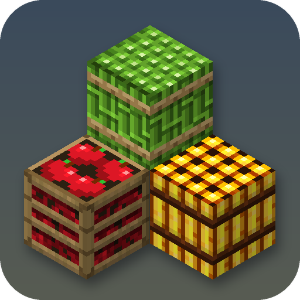
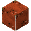
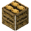
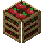
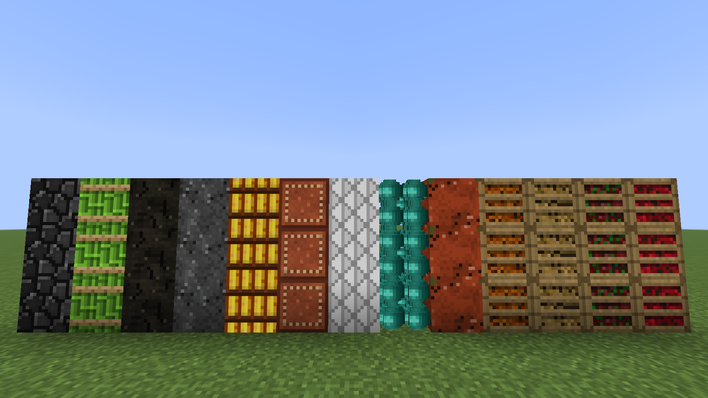
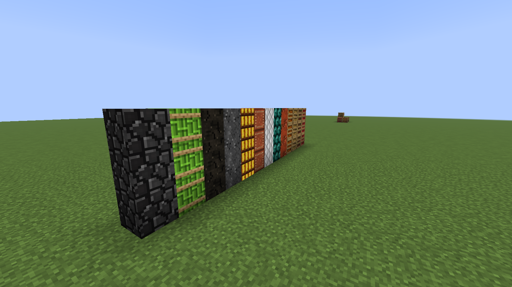
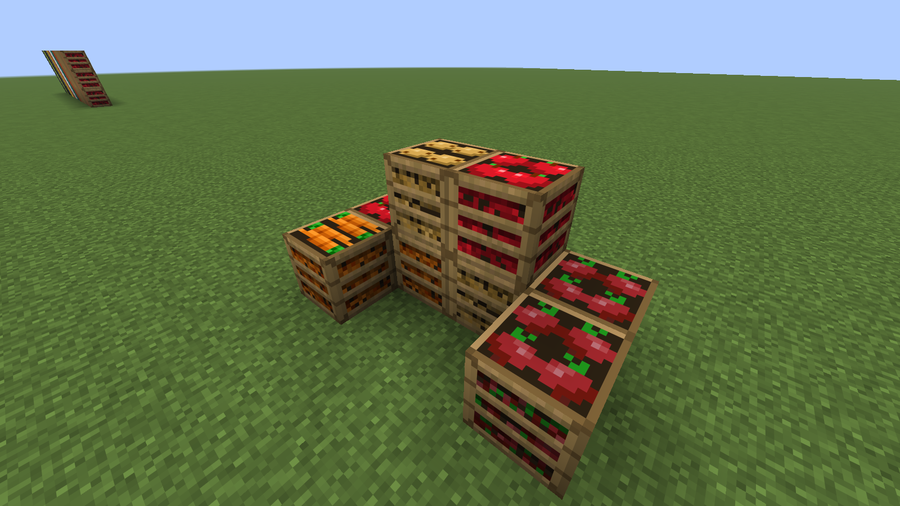
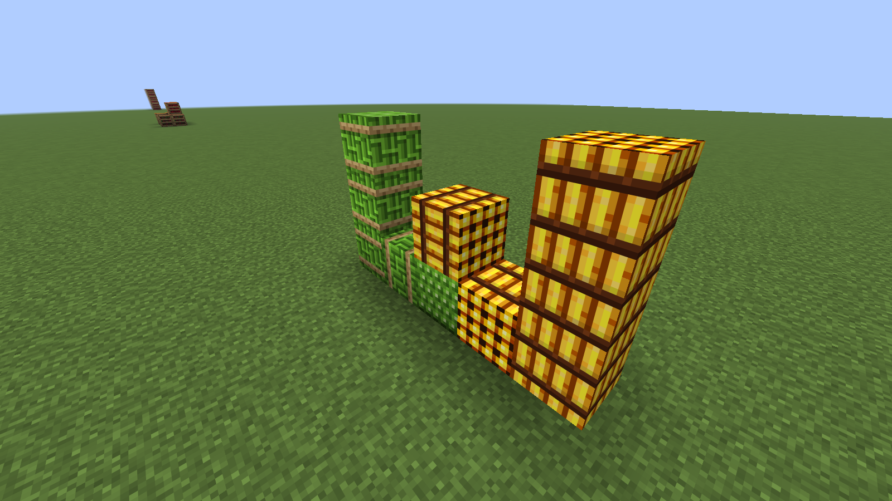
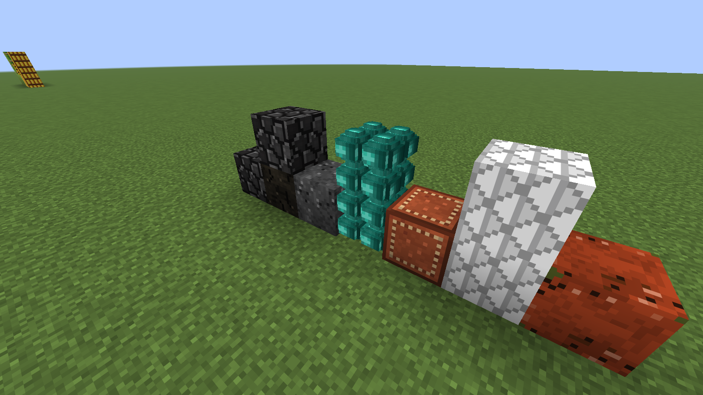
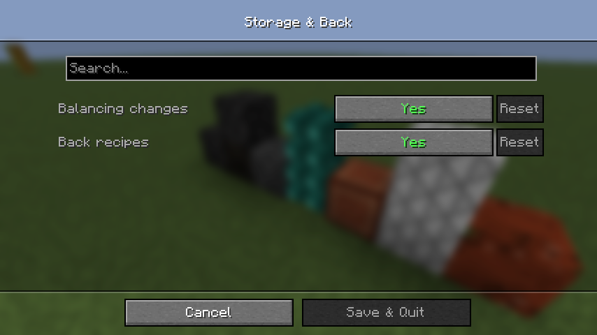

# Storage & Back



A small Fabric mod for Minecraft **26.3** and **26.2** that fills two gaps in vanilla crafting:

* **Storage** – compact storage blocks for items that don't have one (flint, sugar cane, charcoal, gunpowder, blaze rods, leather, feathers, ender pearls, rotten flesh, carrots, potatoes, beetroots and apples).
* **Back** – recipes that turn vanilla blocks back into the items they are crafted from (Block of Quartz → 4 Nether Quartz, Bricks → 4 Bricks, ...).

Every recipe was checked against the vanilla recipe list of both versions: none of them clash with an existing recipe, and nothing can be duplicated.
English and Polish translations.

A **Storage & Back Guide** is crafted shapeless from 1 Book and 1 Flint Block. Right-click it to open a read-only illustrated guidebook: a two-page spread with clickable categories and entries, item icons, and visible crafting recipes. It covers every storage block, the back recipes, and the config toggles (English and Polish), and appears in the **Storage & Back** creative tab.

## Storage blocks

Each block is crafted from 9 items in a full 3×3 grid, and crafts back into the same 9 items.
All of them are unlocked in the recipe book as soon as you pick up the item, appear in their own **Storage & Back** creative tab (with the guide book) and in **Building Blocks**,
and are tagged `c:storage_blocks/<item>` for other mods.

| | Block | Made from | Notes |
|---|---|---|---|
|  | **Flint Block** | 9 Flint | Stone-like, needs a pickaxe. |
|  | **Sugar Cane Bundle** | 9 Sugar Cane | Rotates like a log (axis pillar), burns, compostable. |
|  | **Charcoal Block** | 9 Charcoal | Furnace fuel: 16000 ticks (80 items), same as a Block of Coal. Burns. |
|  | **Gunpowder Block** | 9 Gunpowder | Falls like sand. Does **not** explode. |
|  | **Blaze Rod Bundle** | 9 Blaze Rods | Axis pillar, gives off a little light (level 5). Fuel: 21600 ticks (108 items). |
|  | **Leather Block** | 9 Leather | Soft, wool-like block with stitching. Burns. |
|  | **Feather Block** | 9 Feathers | Landing on it deals only 20% fall damage, like a hay bale. Burns. |
|  | **Ender Pearl Block** | 9 Ender Pearls | A cluster of 9 touching pearls (8 at the corners, 1 in the centre) that you can see between. Pearls only stack to 16, so this stores 9 per slot. |
|  | **Rotten Flesh Block** | 9 Rotten Flesh | Mob-farm storage. Compostable. |
|  | **Carrot Crate** | 9 Carrots | Wooden crate (axe). Burns, compostable. |
|  | **Potato Crate** | 9 Potatoes | Wooden crate (axe). Burns, compostable. |
|  | **Beetroot Crate** | 9 Beetroots | Wooden crate (axe). Burns, compostable. |
|  | **Apple Crate** | 9 Apples | Wooden crate (axe). Burns, compostable. |

## Back recipes

One block (shapeless, anywhere in the grid) gives back the items it is made of:

| Block | Gives | |
|---|---|---|
| Block of Quartz | 4 Nether Quartz |  |
| Block of Amethyst | 4 Amethyst Shards | ⚖️ |
| Clay | 4 Clay Balls |  |
| Glowstone | 4 Glowstone Dust |  |
| Snow Block | 4 Snowballs |  |
| Honeycomb Block | 4 Honeycomb |  |
| Bricks | 4 Bricks |  |
| Nether Bricks | 4 Nether Bricks |  |
| Dripstone Block | 4 Pointed Dripstone |  |
| Prismarine | 4 Prismarine Shards |  |
| Prismarine Bricks | 9 Prismarine Shards |  |
| Dark Prismarine | 8 Prismarine Shards | (the black dye is lost) |
| Magma Block | 4 Magma Cream | ⚖️ |
| Sandstone | 4 Sand |  |
| Red Sandstone | 4 Red Sand |  |

⚖️ = balancing change. Amethyst Blocks generate in geodes and Magma Blocks generate in huge amounts in the Nether,
so these two recipes make Amethyst Shards and Magma Cream much easier to get. They can be turned off in the config.

## Config

`config/storageback.json` (created on first start), also editable in game with **Mod Menu** + **Cloth Config** (both optional):

| Option | Default | What it does |
|---|---|---|
| `balancingChanges` | `true` | **Balancing changes.** `false` removes the *Amethyst Block → 4 Amethyst Shards* and *Magma Block → 4 Magma Cream* recipes. |
| `backRecipes` | `true` | **Back recipes.** `false` removes all the back recipes listed above. Storage blocks are not affected. |

Recipes are server data, so:

* The values are read when the world / server loads its data. After changing them, run **`/reload`** (or leave and rejoin a singleplayer world). The recipe book updates after the reload.
* In singleplayer the Mod Menu screen changes your own `config/storageback.json`, which is the file the built-in server uses.
* On a **dedicated server** edit the server's `config/storageback.json`, then `/reload` or restart. The client's settings don't matter there.

The toggles are implemented as a Fabric resource condition (`storageback:config`) in `fabric:load_conditions`, so data packs can use it too.

## Installation

* Fabric Loader 0.19.5+ and **Fabric API**.
* Optional: [Mod Menu](https://modrinth.com/mod/modmenu) and [Cloth Config](https://modrinth.com/mod/cloth-config) for the config screen.
* The mod adds blocks, so it is needed **on both the server and every client**.

## Screenshots








## Building

Branches: `master` → Minecraft 26.3, `26.2` → Minecraft 26.2. Java 25.

```
./gradlew build                                      # jar in build/libs, also runs the server game tests
SDL_VIDEODRIVER=offscreen ./gradlew runClientGameTest # real client: builds scenes and saves screenshots
python3 tools/gen_data.py      # regenerates blockstates, models, recipes, advancements, loot tables, tags, lang (also rebuilds the 9-pearl model)
python3 tools/gen_pearl_model.py # just the Ender Pearl Block 3D model and texture
python3 tools/gen_textures.py  # regenerates the block textures
python3 tools/gen_icon.py      # regenerates the mod icon and the docs/icons table icons
```

The server game tests check that all 42 recipes and their recipe-book advancements load, that every recipe grid matches
**only** its own recipe among all crafting recipes of the game, that turning *Balancing changes* off and reloading removes exactly
the two recipes, and the block properties (fuel, flammability, composting, falling, light).

## License

MIT
